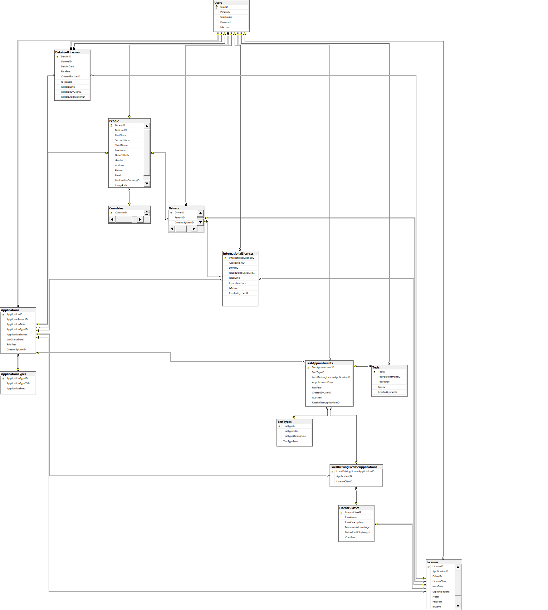

# 🚗 Driving & Vehicle License Department System (DVLD)

> **🚧 Project Status:** Work In Progress (WIP) — Currently implementing core licensing and testing workflows.

## 📌 Overview
**DVLD** is a comprehensive desktop application built to simulate and automate the real-world operations of a government Driving and Vehicle License Department. The system manages the complete lifecycle of applicants, system users, drivers, driving tests (Vision, Written, and Street(Driving)), local and international license issuance, and detained license releases.

---

## 🏗️ Architecture & Tech Stack
This project is built from scratch following a strict **3-Tier Architecture** to ensure clean separation of concerns, scalability, and maintainability:

* **Presentation Layer (`PresentationLayer[DVLD]`):** Windows Forms (.NET Framework) utilizing custom, reusable **User Controls** (`ctrlPersonCard`, `ctrlFilter`, etc.).
* **Business Logic Layer (`BusinessLayer[DVLD]`):** C# Class Library enforcing business rules, validations, and data processing.
* **Data Access Layer (`DataAccessLayer[DVLD]`):** C# Class Library using direct **ADO.NET** (`SqlConnection`, `SqlCommand`, `SqlDataReader`) for high-performance database communication.
* **Database (`Database/`):** Microsoft **SQL Server** (Normalized relational database).

---

## ✨ Key Features & Technical Highlights
* **People & Users Management:** Full CRUD operations with national number uniqueness validation, role-based access, and user authentication.
* **Smart Image Handling (GUID-Based Storage):** Instead of bloating the database with binary images or risking file-name collisions, applicant photos are automatically copied to a dedicated local directory and renamed using uniquely generated **GUIDs** (`GUID + Extension`), storing only the lightweight reference path in SQL Server.
* **Applications & Test Scheduling:** Tracks application statuses (New, Cancelled, Completed) and enforces sequential passing of **Vision**, **Written**, and **Street (Practical)** tests before issuing a license.
* **License Operations:** Supports first-time license issuance, renewals, replacements for lost/damaged licenses, **International Driving Licenses**, and detaining/releasing licenses after fine settlement.
* **Reusable UI Components:** Heavy utilization of WinForms **User Controls** and event delegation to minimize code duplication across forms.

---

## 🗄️ Database Design (ER Diagram)
The SQL Server script and schema are located in the [`Database/`](./Database) folder.

<!-- إذا وضعت صورة المخطط داخل مجلد Database باسم DVLD_Diagram.png احذف علامتي التعليق من السطر التالي لتظهر الصورة تلقائياً -->
!--  --

---

## 🚀 How to Run the Project Locally
1. **Clone the repository:**
   ```bash
 git clone "[https://github.com/Yusuf-SHAABAN-ARJA/Driving-License-Management-System(DVLD).git](https://github.com/Yusuf-SHAABAN-ARJA/Driving-License-Management-System(DVLD).git)"
